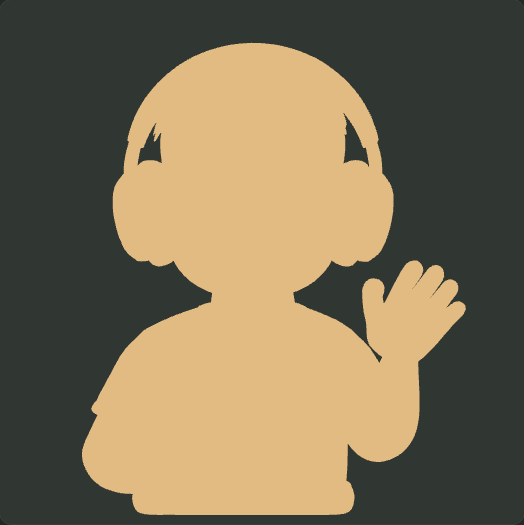
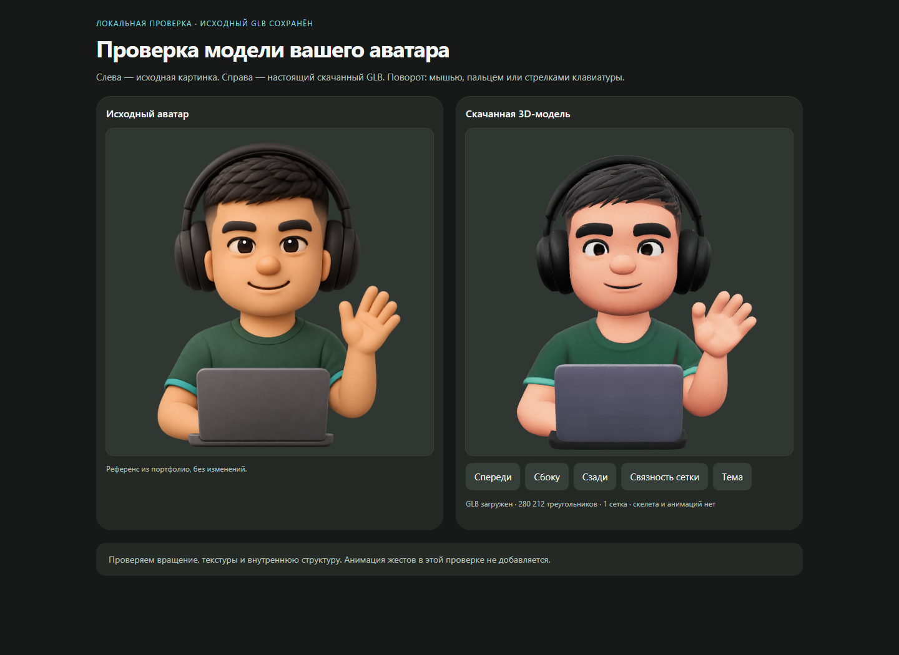

# Проверка скачанного 3D-аватара

## Вывод

Модель подходит как исходная статическая 3D-реконструкция: она загружается с текстурами и поворачивается в браузере. Готовой анимации рук или наушников в ней нет. Взмах рукой можно подготовить, добавив скелет и веса деформации; снятие наушников требует ещё и отделения геометрии с восстановлением закрытых ими областей головы. Ни один из этих жестов пока не реализован и не проверен в движении.

Проверка выполнена локально, без изменения исходного GLB и без публикации. Созданы только материалы аудита в `portfolio/audit/avatar-model-review` и диагностический файл связности в уже игнорируемом `portfolio/audit/avatar-guide/runtime/reconstruction`. Файлы сайта не менялись, проект «Парсер» не изменялся.

## Какой файл проверен

В `assets/guide/avatar.glb` файла нет. Внутри portfolio найден скачанный файл с исходным именем:

- [sample_2026-11-09T202723.078.glb](../avatar-guide/sample_2026-11-09T202723.078.glb)
- Размер: **13 561 056 байт** — 13,56 МБ, или 12,93 МиБ.
- SHA-256 до и после проверки: `5184f961b0ba403f1060d836d1b68a935d47d6d220ac967924235349f013c9c1`.
- Формат: GLB 2.0; текстуры и буфер встроены, внешних ресурсов нет.

Файл не перемещался, не переименовывался и не перезаписывался. Подробный разбор: [structure-check.json](structure-check.json), [gltf-structure.json](gltf-structure.json).

## Фактическая структура

| Свойство | Результат |
|---|---|
| Узлы | `world` → `geometry_0` |
| Сетки / примитивы / материалы | 1 / 1 / 1 |
| Вершины / треугольники | 287 631 / 280 212 |
| Атрибуты | `POSITION`, `TEXCOORD_0`, `NORMAL` |
| Скелеты (`skins`) | 0 |
| Веса и суставы (`WEIGHTS_0`, `JOINTS_0`) | Отсутствуют |
| Готовые анимации | 0 |
| Морф-мишени | 0 |
| Текстуры | Две встроенные WebP, обе 2048 × 2048: цвет и metallic/roughness |
| Обязательное расширение | `EXT_texture_webp` |

Одной сетки самой по себе недостаточно, чтобы утверждать, что все части физически спаяны. Поэтому дополнительно проверена связность треугольников. У сетки много разрывов индексов на UV-швах. После диагностического объединения совпадающих координат с точностью `1e-6` найдена 101 компонента; главная содержит 277 327 вершин и визуально включает тело, голову, обе руки и чашки наушников. Остальные компоненты не представлены в GLB как самостоятельные именованные объекты. Эта оценка показывает связность, а не анатомическое разделение и не гарантирует замкнутость поверхности.

## Возможность анимации

| Действие | Сейчас | Что потребуется |
|---|---|---|
| Вращение всей модели | Работает, проверено по реально отрисованным изображениям | Управление камерой либо корневым узлом |
| Небольшой наклон/появление всей модели | Технически доступна трансформация корневого узла; отдельный сценарий не добавлялся | Анимация `rotation`/`translation` корня |
| Взмах уже поднятой рукой | Нет подготовленных суставов, весов или отдельной руки | Подготовить плечо/локоть/кисть, назначить веса вершинам, проверить швы рукава, объём локтя и пересечения; затем добавить и проверить анимацию |
| Движение пальцев | Нет | Дополнительные кости пальцев, веса и проверка геометрии ладони; существенно сложнее простого взмаха кистью |
| Приподнять чашку наушников при наведении | Чашки не являются отдельными управляемыми объектами | Выделить нужную геометрию, закрыть места разреза, задать точку вращения и убедиться, что голова не деформируется вместе с чашкой |
| Снять и снова надеть наушники | Готовой возможности нет | Отделить и подготовить весь аксессуар, восстановить скрытые им участки головы/волос/ушей, затем согласовать траектории наушников и рук и проверить пересечения |

Это вывод о необходимых этапах подготовки, а не обещание готового автоматического риггинга. Наличие статического GLB не означает наличия суставов. В glTF деформация через скелет описывается `skins`, иерархией суставов и атрибутами суставов/весов; у этого файла их нет. [Спецификация glTF: Skins](https://registry.khronos.org/glTF/specs/2.0/glTF-2.0.html#skins).

Для одного небольшого приветствия достаточно начать с ограниченного движения кисти/предплечья. Для жеста снятия наушников потребуется отдельная подготовка аксессуара и скрытой поверхности головы. Автоматические веса могут дать неверные деформации и требуют проверки и ручной коррекции. [Blender: Armature Deform Parent](https://docs.blender.org/manual/en/2.90/animation/armatures/skinning/parenting.html).

## Состояние модели и ограничения

Внешность узнаваемо следует иллюстрации: сохранены наушники, зелёная футболка, ноутбук и поднятая рука. При этом реконструкция не совпадает с исходником пиксель в пиксель: отличаются пластика лица, линия волос и детали материалов. На крупных видах заметны неровности и тонкие дефекты поверхности/текстуры, особенно на волосах и задней части головы. Визуальное принятие пользователем ещё не получено; модель на сайте не заменялась.

Официальный Khronos glTF Validator `2.0.0-dev.3.10` обнаружил **1 ошибку, 0 предупреждений, 4 подсказки**:

- `ACCESSOR_VECTOR3_NON_UNIT`: у вершины **151166** нормаль равна `(0, 0, 0)` вместо единичного вектора. Позиция вершины: `(-0.10378664, 0.27570772, -0.27621248)`. Наш независимый проход подтвердил ровно одну нулевую нормаль и отсутствие нечисловых значений нормалей. При подготовке производной модели эту нормаль необходимо восстановить и повторить валидацию.
- Четыре `BUFFER_VIEW_TARGET_MISSING` имеют уровень **hint**: для буферов позиций, UV, нормалей и индексов не задан `bufferView.target`. Это не четыре дополнительные ошибки.

Исходник не исправлялся: задача этой проверки — оценить предоставленную модель. [Полный отчёт валидатора](validator-report.json), [официальный валидатор](https://github.com/KhronosGroup/glTF-Validator).

13,56 МБ и 280 тысяч треугольников — значительный объём для небольшого аватара на странице. Перед размещением нужна отдельная оптимизированная копия: уменьшение геометрии и текстур с контролем лица/пальцев/наушников, подходящее сжатие и отложенная загрузка с прежней картинкой как запасным вариантом. Конкретный допустимый размер следует подтвердить измерением на сайте. Lighthouse опубликованного сайта в этой проверке не запускался, поскольку его файлы не менялись; быстродействие страницы с внедрённым GLB пока не проверено.

## Проверки отображения

Локальный Three.js-просмотрщик реально загрузил исходный GLB и обе текстуры в Chrome/WebGL 2.0. На ширинах **1440 и 390 px**, в светлой и тёмной темах:

- получены непустые виды спереди, сбоку и сзади; различие кадров при повороте проверено по изображениям, а не только по значению угла;
- управление стрелками и Home работает; мышиное перетаскивание отдельно проверено на ширине 1440;
- включение диагностической раскраски связности работает;
- обе текстуры декодированы в 2048 × 2048;
- ошибок JavaScript/HTTP, горизонтального переполнения и внешних HTTP-запросов нет; локальные `blob:` используются для встроенных текстур;
- SHA-256 исходного GLB после проверки не изменился.

Ширина 390 px проверена в headless Chrome, а не на физическом телефоне. Реальное сенсорное управление, FPS на телефоне, анимация деформаций, исправление нормали и оптимизация не проверялись и не объявляются готовыми.

Доказательства: [render-checks.json](render-checks.json), [вид сбоку](side-1440.png), [вид сзади](back-1440.png), [светлая тема](comparison-light-1440.png), [ширина 390 px](comparison-dark-390.png). Для повторения в этом workspace: запустить локальный `audit/avatar-3d/server.cjs`, затем `node audit/avatar-model-review/check-render.cjs`. Проверки структуры: `node audit/avatar-model-review/inspect.cjs`. Команда `node audit/avatar-model-review/validate.cjs` намеренно возвращает ненулевой код, пока ошибка нормали исходника не устранена в отдельной производной копии.
